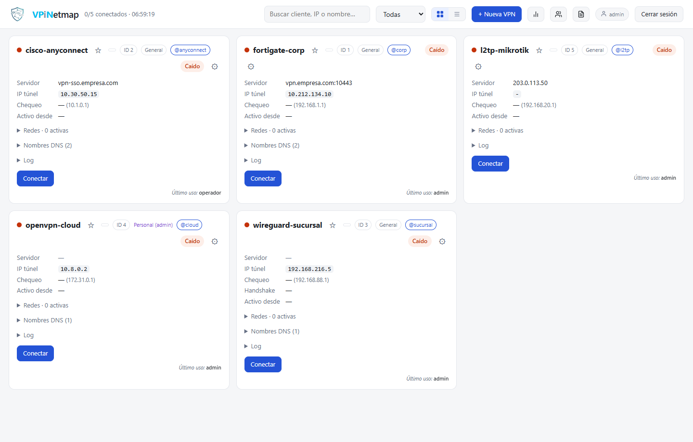
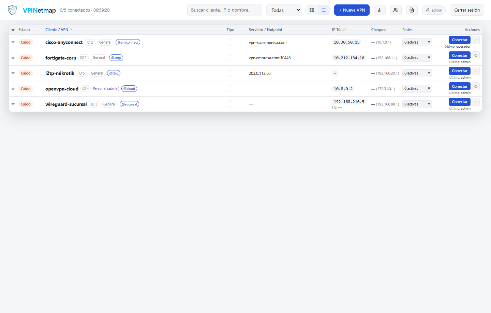
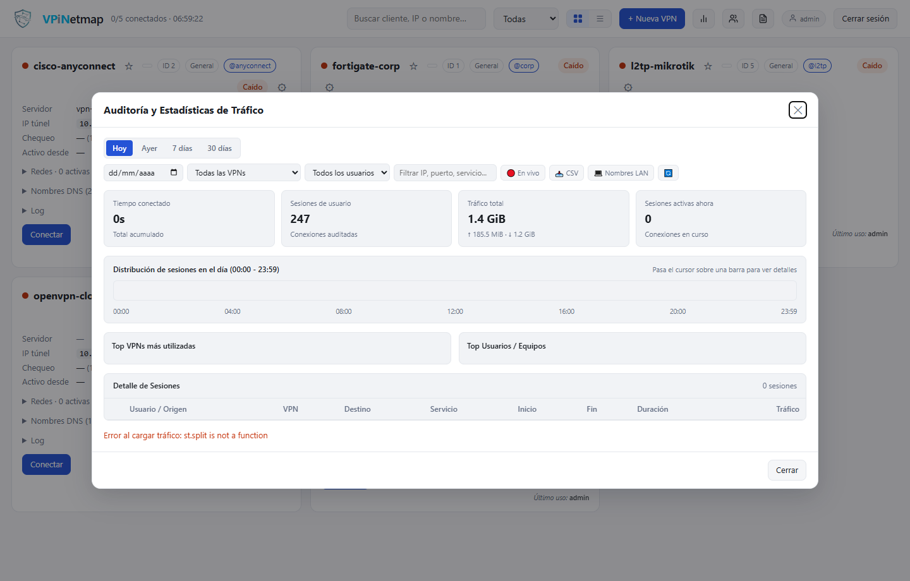
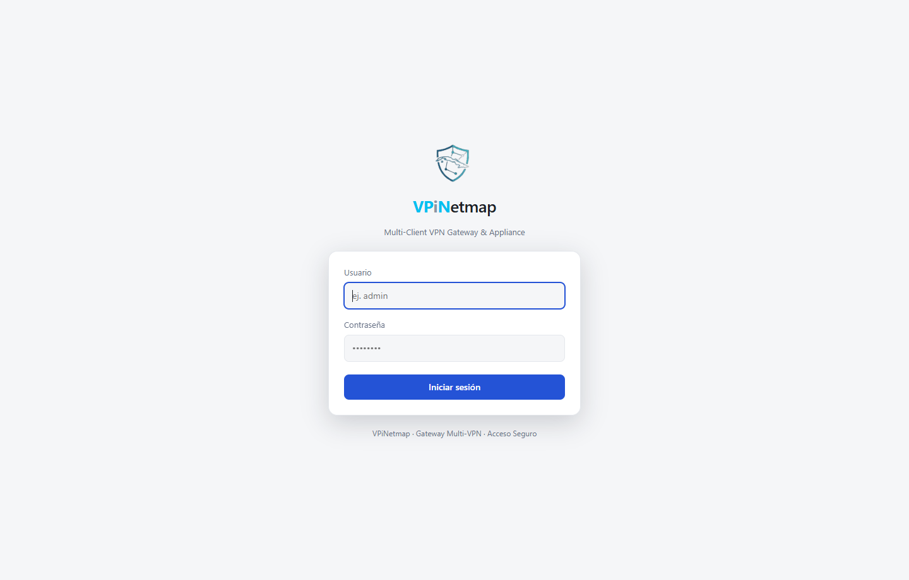

<p align="center">
  
</p>

<h1 align="center">VPiNetmap</h1>

<p align="center">
  <b>Multi-Client VPN Gateway & Appliance</b><br>
  Plataforma unificada para mantener múltiples túneles VPN conectados 24/7 en Linux, resolviendo automáticamente colisiones de subredes idénticas mediante Network Namespaces aislados y NETMAP de iptables. Administrable vía interfaz web HTTPS con autenticación 2FA y auditoría de tráfico.
</p>

---

## Características Principales

- **Múltiples Tecnologías Soportadas:**
  - FortiGate SSL VPN (`openfortivpn`) con soporte OTP.
  - FortiGate IPsec Dialup (`strongSwan` con IKEv2 / EAP / XFRM y `vpnc` con IKEv1 / Aggressive Mode).
  - Cisco AnyConnect / OpenConnect con soporte tradicional y SAML / Duo Push Universal Prompt.
  - WireGuard (MikroTik Back-To-Home, Linux, etc.) con verificación activa de endpoints dinámicos.
  - OpenVPN (.ovpn con certificados embebidos).
  - L2TP/IPsec (strongSwan + xl2tpd).
- **Aislamiento por Network Namespaces (`vpn-<cliente>`):** Cada cliente corre en su propio namespace de red, eliminando por completo cualquier interferencia o conflicto de IPs entre clientes.
- **NETMAP Virtual (`10.(200+ID).X.Y`):** Traducción bidireccional que permite a la red local acceder a cualquier equipo remoto sin modificar rutas en la red física del cliente.
- **DNS Sintético Automatizado:** Resolución dinámica `<IP_real>.<alias>` o `<nombre>.<alias>.hub` mediante `dnsmasq`.
- **Servidor WireGuard Road Warrior Integrado:** Entrega perfiles descargables para que técnicos y operadores accedan a las VPNs desde cualquier lugar con un solo clic.
- **Auditoría de Tráfico en Tiempo Real (`conntrack`):** Registro de sesiones de usuarios hacia las VPNs con estadísticas de duración, servicios (RDP, Web, SSH, DB) y volumen de bytes.
- **Panel Web Moderno:** Interfaz responsiva sin dependencias externas (HTML5/CSS3/Vanilla JS) con 2FA (TOTP y Cisco Duo), vistas en lista y cuadrícula.

---

## Interfaz Web y Capturas de Pantalla

### 1. Tablero Principal (Vista Cuadrícula)
Monitoreo visual en tiempo real de cada túnel VPN con estado de conexión, latencia ping, transferencia acumulada de subida/bajada y accesos a redes mapeadas.

<p align="center">
  
</p>

### 2. Vista de Lista Detallada (Estilo Explorador)
Vista tabular densa con ordenamiento dinámico por columnas, resolución automática de endpoints (WireGuard/OpenVPN) y menú desplegable de subredes.

<p align="center">
  
</p>

### 3. Configuración y Ajustes de VPN
Administración en caliente de parámetros de conexión, credenciales de autenticación, alcance (General / Personal), alias DNS corto y subredes NETMAP.

<p align="center">
  
</p>

### 4. Auditoría y Estadísticas de Tráfico (`conntrack`)
Línea de tiempo interactiva de 24 horas, KPIs de tráfico y sesiones activas, ranking de consumo por VPN/usuario y registro detallado de conexiones (RDP, Web, SSH, SQL).

<p align="center">
  
</p>

### 5. Pantalla de Acceso Seguro
Inicio de sesión moderno con soporte de doble factor de autenticación (Google Authenticator TOTP y Cisco Duo Push) y flujo obligatorio de cambio de contraseña en el primer acceso.

<p align="center">
  
</p>

---

## Estructura del Proyecto

```text
vpinetmap/
├── bin/                 # Orquestadores y utilitarios CLI (hubctl, hubtraffic, updown)
├── panel/               # Backend HTTPS en Python y frontend web ligero
├── systemd/             # Servicios y timers para ejecución continua
├── examples/            # Plantillas y ejemplos de configuración para cada tipo de VPN
├── proxmox/             # Script automatizado para desplegar la VM en Proxmox VE
└── install.sh           # Script de instalación automática en un comando
```

---

## Instalación Rápida (Debian 12 / 13 / Ubuntu)

En un servidor o máquina virtual recién instalada:

```bash
git clone https://github.com/ppinet-commits/vpinetmap-public.git
cd vpinetmap-public
sudo bash install.sh
```

El script configurará los paquetes del sistema, las rutas y las unidades systemd de forma totalmente desatendida.

### Credenciales de Acceso Inicial
Una vez finalizada la instalación, ingresa a `https://<IP_DEL_SERVIDOR>:8443` (o `https://vpnhub.hub:8443`):

| Parámetro | Valor Inicial |
|---|---|
| **Usuario** | `admin` |
| **Contraseña** | `admin` |
| **Primer inicio de sesión** | **Cambio obligatorio:** se solicitará definir una nueva contraseña segura (mínimo 8 caracteres) antes de habilitar el acceso al panel |

---

## Despliegue en Proxmox VE

Para crear una VM lista con imagen cloud de Debian:

```bash
bash proxmox/crear-vm-vpnhub.sh
```

---

## Licencia

Distribuido bajo licencia MIT. Libre para uso personal y comercial.
